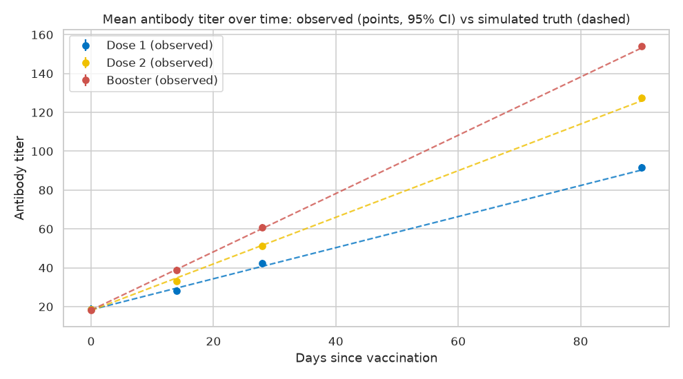

# Vaccine Response Simulation (Python)

[](https://github.com/lukahere007/vaccine-simulation-python/actions/workflows/ci.yml)

**Question:** if we simulate a three-arm vaccine study (Dose 1, Dose 2, Booster; 500 patients; antibody titers at Days 0, 14, 28 and 90), do standard analyses (OLS/ANOVA, logistic regression, a linear mixed model) recover the effects we built into the simulation, and what goes wrong when repeated measurements are treated as independent?

**Answer:** the dose effects are recovered closely, and the failures are the instructive part. A real but small comorbidity penalty is missed at Day 28 alone and only found with all timepoints. A covariate with no true effect still comes out "significant" in one model. When patients have their own baseline, OLS on pooled timepoints gives "95%" intervals that cover the truth only 73.5% of the time, against 92.0% for a mixed model.

> **These are simulated data.** The booster "wins" because the simulation gives it the steepest slope. Nothing here is evidence about real vaccines; the project demonstrates a design-and-analysis workflow and checks it against a known truth.

A companion R version of the same simulation is at [lukahere007/vaccine-immune-response](https://github.com/lukahere007/vaccine-immune-response).

## Key results (`np.random.seed(123)`)

**Day 28, one row per patient.** ANOVA F(2, 497) = 106.4, p ≈ 3e-39.

| Comparison | True difference | Estimate | 95% CI |
|---|---|---|---|
| Dose 1 − Booster | −19.6 | −18.6 | −21.1 to −16.1 |
| Dose 2 − Booster | −8.4 | −9.6 | −12.1 to −7.1 |

Odds of seropositivity (titer > 50) vs. booster: 0.06 for Dose 1, 0.26 for Dose 2 (both p < 0.001). No comorbidity term is significant (Hypertension p ≈ 0.05) despite a real penalty of about 3.5 units: a power problem, not an absence of effect.



**All timepoints, mixed model** (random intercept per patient, 2,000 rows):

| Parameter | True value | Estimate | 95% CI |
|---|---|---|---|
| Slope per day, Dose 1 | 0.8 | 0.818 | 0.797 to 0.839 |
| Slope per day, Dose 2 | 1.2 | 1.214 | 1.192 to 1.235 |
| Slope per day, Booster | 1.5 | 1.513 | 1.493 to 1.533 |
| Any comorbidity | −3.5 (average) | −4.26 | −5.28 to −3.24 |
| Sex (male) | 0 | −1.05 | −2.07 to −0.04 (false positive) |
| Age | 0 | −0.003 | −0.037 to 0.030 |
| BMI | 0 | −0.123 | −0.250 to 0.005 |

**Repeated simulation.**

| Check | Result | Expected |
|---|---|---|
| Day-28 95% CI covers the true Dose 1 − Booster difference (500 runs) | 94.4% | ~95% |
| Logistic model calls BMI significant at p < 0.05 (500 runs) | 4.0% | ~5% |
| Comorbidity CI coverage, patients with own baseline (SD 10), **OLS on pooled rows** (200 runs) | 73.5% | 95% |
| Same, **mixed model** | 92.0% | 95% |

## Method

1. Simulate 500 patients (age, sex, BMI, comorbidity, randomly assigned dose). Titer = N(20, 5²) + slope(dose) × day − U(2, 5) if any comorbidity + N(0, 10²).
2. Day 28 cross-section: one-way ANOVA via OLS, and logistic regression for seropositivity (one row per patient, so observations are independent).
3. All timepoints: `statsmodels` `MixedLM` with a random intercept per patient, parameterised so every coefficient has a known true value.
4. Compare every estimate with the truth; repeat the simulation to check coverage and false-positive rates; add a patient random effect to show why pooled OLS is wrong for longitudinal data.

## Repository structure

```
├── Vaccine_response_simulation.ipynb   # the analysis (executed, with outputs)
├── data/simulated_vaccine_data_python.csv  # written by the notebook (500 patients x 4 timepoints)
├── figures/                            # PNGs written by the notebook
├── requirements.txt
└── .github/workflows/ci.yml            # executes the notebook on every push
```

Note: when loading the CSV with pandas, use `pd.read_csv(..., keep_default_na=False)`. Otherwise the comorbidity value `"None"` is read as missing.

## How to run

```bash
git clone https://github.com/lukahere007/vaccine-simulation-python.git
cd vaccine-simulation-python
python -m venv venv && source venv/bin/activate   # Windows: venv\Scripts\activate
python -m pip install -r requirements.txt
python -m jupyter nbconvert --to notebook --execute --inplace Vaccine_response_simulation.ipynb
```

Full execution takes about two minutes (most of it is the repeated simulations in Section 5). Tested with Python 3.11, numpy 2.4, pandas 3.0, statsmodels 0.15.

## Limitations

- **Simulated, not real.** All effects are inputs to the simulation.
- **Unrealistic time course.** Titers rise linearly forever; there is no peak and no waning, so the plots say nothing about durability of protection.
- **No within-patient correlation in the main simulation.** Each timepoint draws a fresh baseline. Section 5d adds a patient random effect to show the consequences; the main analysis does not.
- Python and R versions use the same parameters but different random number generators, so their numbers differ.

## Author

Luke Wamalwa ([GitHub](https://github.com/lukahere007)). MIT License.
